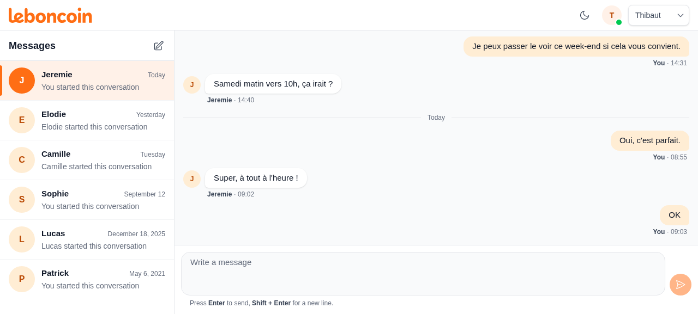
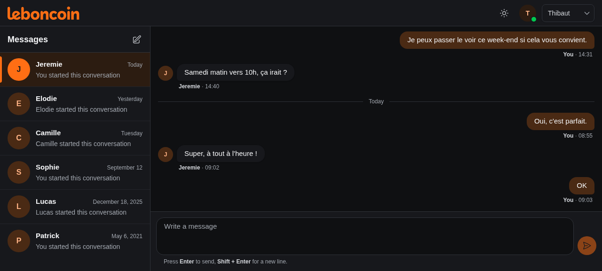
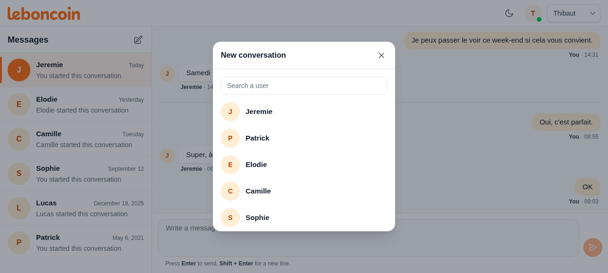
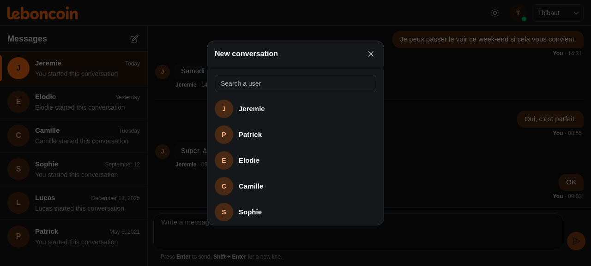
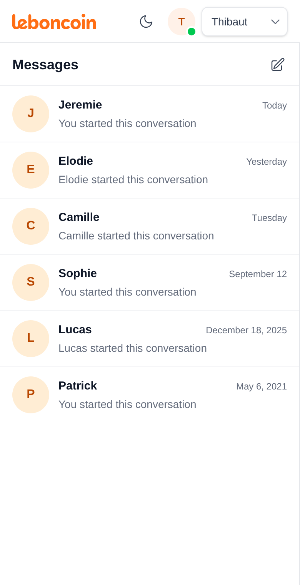
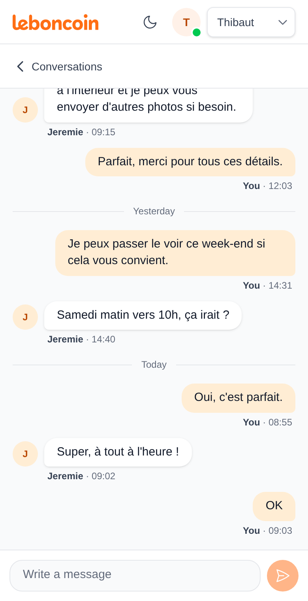
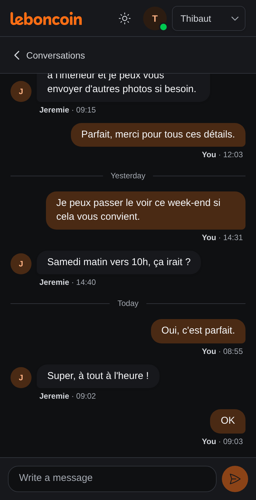
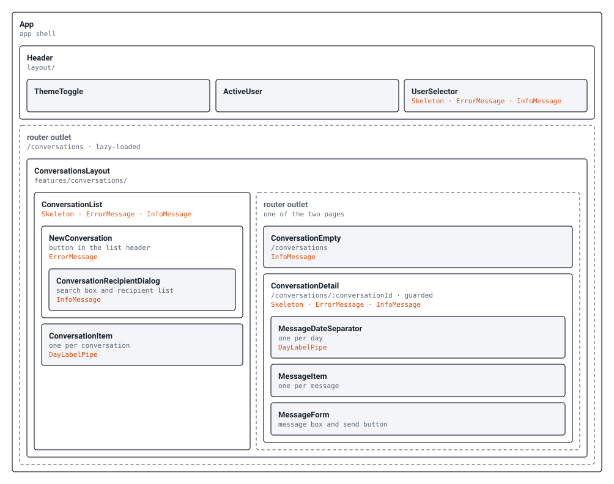
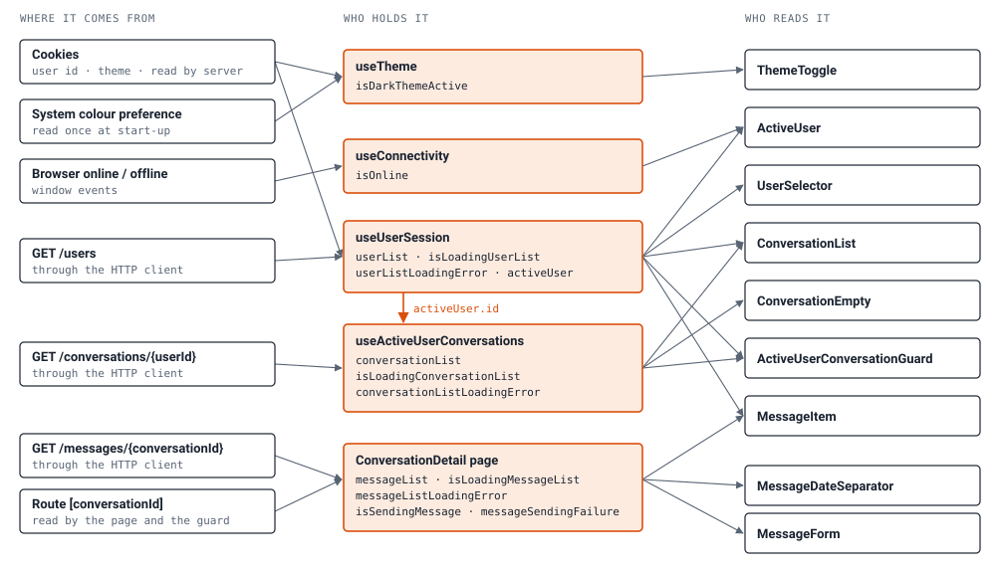

# leboncoin messaging app

A messaging app for leboncoin users: read your conversations and reply about a transaction or a product, on desktop and on phone. Built with Next.js 16 (App Router), React 19, the React Compiler, TanStack Query and Tailwind CSS 4.

This project is my implementation of the [leboncoin frontend technical test](https://github.com/leboncoin/frontend-technical-test). Below: what I built, how it moved from Angular to Next.js and React, the decisions behind it and how the code is organised.

The look follows leboncoin's own website: its orange, its logo, rounded shapes and an avatar with each contact's initial. The layout is responsive. On desktop the conversation list and the open conversation sit side by side; on a phone they are two screens, with a link back to the list.

<table>
  <tr>
    <th width="50%">Desktop, light theme</th>
    <th width="50%">Desktop, dark theme</th>
  </tr>
  <tr>
    <td></td>
    <td></td>
  </tr>
  <tr>
    <th>Desktop, new conversation dialog</th>
    <th>Desktop, new conversation dialog (dark theme)</th>
  </tr>
  <tr>
    <td></td>
    <td></td>
  </tr>
</table>

<table>
  <tr>
    <th width="33%">Phone, conversation list</th>
    <th width="33%">Phone, open conversation</th>
    <th width="33%">Phone, open conversation (dark theme)</th>
  </tr>
  <tr>
    <td></td>
    <td></td>
    <td></td>
  </tr>
</table>

## Run it

Node 22 is required. The mock API runs on `json-server` 0.x, installed globally (1.x dropped the `--routes` and `--middlewares` options the start script uses).

```bash
npm install -g json-server@0.16.3
npm install
npm run start-server   # mock API on http://localhost:3005, in a first terminal
npm run start-app      # app on http://localhost:4200, in a second terminal
```

On a first visit the app starts as the first user of the list; the selector in the header switches to another one.

- `npm run test`: unit tests with coverage; fails under 100% on statements, branches, functions or lines.
- `npm run lint`: ESLint with the Next.js, accessibility and React Compiler rules; fails on any warning.
- `npm run build`: type check and production build; `npx next start` serves it.

A pre-commit hook runs Prettier on the staged files, then the linter and the tests.

To try a slow server, start it with a delay in milliseconds: `npm run start-server -- --delay 3000`. Under 10 seconds the skeletons and "Sending…" stay that long; above it the app's timeout shows "The service is temporarily unavailable" with "Try again". With the server stopped, the app shows "Can't reach the server". The delay applies to users and messages, not to the conversation list, which the provided middleware answers first.

## What is built

| Asked                                       | How it works                                                                  |
| ------------------------------------------- | ----------------------------------------------------------------------------- |
| List all conversations                      | Conversations of the active user, most recent first                           |
| Select a conversation and read its messages | Messages grouped by day, with author and time                                 |
| Type and send a message                     | Message box at the bottom of the open conversation                            |
| Desktop and mobile                          | Two panes on desktop; list, then conversation, on phone                       |
| Robust safety guards                        | See [Safety guards](#safety-guards)                                           |
| Bonus 1: create a conversation              | "New conversation" button, with a searchable list of users                    |
| Bonus 2: handle server crashes gracefully   | Every failed or unanswered request shows a clear error and "Try again"        |
| Accessibility                               | Lighthouse accessibility score of 100 on the list and on an open conversation |
| Tests                                       | Unit tests at 100% coverage, checked before every commit                      |

Added on top: a user selector in the header (the API has no login, so this is how you become one of the users), a light and dark theme, and loading skeletons that mirror the final layout.

## From Angular to Next.js and React

The app was first written in Angular 22; the git history up to the README commit shows it built feature by feature. One commit then moves it to Next.js 16 and React 19.

**What did not change:** the behaviour (every list state, "Try again", the 10-second timeout, the guard, "Sending…" and retry), the look, the architecture and its names, the tests (ported suite by suite, still at 100%) and the mock server.

| Angular                                      | React / Next.js                                                | Why                                                           |
| -------------------------------------------- | -------------------------------------------------------------- | ------------------------------------------------------------- |
| Services holding lists in signals            | Hooks reading a shared TanStack Query cache                    | Components reading the same list share one request            |
| HTTP interceptor                             | One HTTP client over `fetch`, cut after 10 seconds             | Still the single place that turns failures into an `AppError` |
| `canActivate` guard                          | A guard component around the page                              | The access rule stays in one place, outside the page          |
| `linkedSignal` resetting the page state      | A key on the page, made of the user and the conversation       | A new key gives a new page with empty state                   |
| `computed` values                            | Values computed in the component, cached by the React Compiler | No `useMemo` or `useCallback` to write                        |
| `localStorage` for the active user and theme | Cookies, which the Next.js server can read                     | A saved dark theme shows from the first page load             |

**How it was verified:** Prettier, ESLint with no warning, the type check, the build and the tests at 100% coverage pass; in Chrome, against the mock server, on desktop and phone, light and dark, every flow and every failure path in this README works without a console warning.

## Design decisions

### Where state lives

Users and conversations are read by several components, so each has a shared hook: `useUserSession` and `useActiveUserConversations`. Both read the TanStack Query cache, so the components share one request. Messages are read by one page only, so `ConversationDetail` loads them itself.

The active user id is the only value the app keeps on its own. It sits in a small context, `ActiveUserIdProvider`, and is saved in a cookie.

### Reloading

Each list is loaded for what it depends on: the conversations for the active user, the messages for the open conversation. When the user or the conversation changes, the right list loads by itself.

A list loads once, then reloads only on "Try again" (`staleTime: Infinity`). Reloading it automatically would remove a conversation just created, because the provided server only returns the conversations it had when it started (observation 3).

A list that is no longer on screen is dropped (`gcTime: 0`). Coming back to a conversation or a user shows the skeleton, then fresh data.

### Errors

One HTTP client turns every failure into an `AppError` with a kind: `network`, `not-found`, `server`, `unauthorized`, `unavailable` or `unknown`. Components pick a text and an icon from the kind and never read a status code. Since the brief says the servers are shaky, every request is cut after 10 seconds and shown as `unavailable`, so the screen never waits forever. A render error under the header shows `app/error.tsx`, with "Try again".

### Rendering and access to a conversation

The Next.js server renders every page from two cookies: the active user and the theme. A saved dark theme is in the first HTML, so it never flashes light.

The lists still load in the browser, with their skeleton, error and "Try again". The server shows the same skeleton as the browser's first render, so nothing changes when the browser takes over. The same goes for the values only the browser knows, the online status and the system theme: the server uses a default.

Only a participant can open a conversation. That rule lives in one place, a guard component around the page. The guard runs in the browser on purpose: the provided server does not know about a conversation created since it started (observation 3), so a guard on the server would send the user away from every new conversation. The guard gives the page the active user through `useConversationParticipant()`.

### Sending a message and creating a conversation

Both use TanStack Query's `useMutation`. React 19's `useActionState` was not used: while it waits for the server, it also holds back navigation, so opening another conversation during a slow send would hang. `useOptimistic` was not used either: a message appears only once the server accepts it, after "Sending…".

Each conversation gets its own page, keyed by the active user and the conversation. A message still sending when the user opens another conversation is not cancelled. Its answer goes to the old page, which is no longer on screen, so nothing shows up in the wrong conversation. The message is there when the user comes back.

The "New conversation" button appears once the conversation list has loaded, so choosing a recipient opens the existing conversation with them, or creates one if there is none.

### Shared components and colours

`Skeleton`, `ErrorMessage`, `InfoMessage` and the date utils know nothing about users or conversations, so the three lists load, fail and empty the same way. Components use colour tokens named by role (`surface`, `content`, `line`); the dark theme redefines them in one place. Without a saved choice the app follows the system preference.

### What I left out

- Deleting a conversation or a message: the mock server answers `404` to every delete (observation 8), and the exercise does not ask for it.
- Sending the user's token: the documentation never says how (observation 1).

## Safety guards

- The guard redirects anyone who is not a participant of the requested conversation, after a page reload or a change of user too. It is not access control (observation 2).
- Any request can fail, or stay unanswered for 10 seconds, without breaking the screen: the user sees what happened and can try again.
- The send button is disabled for an empty message, while a message is sending, while a failed message waits for its retry, and while the messages load or failed to load.
- A message is limited to 1000 characters, in the message box and again before sending. The API documents no limit; this is the app's choice.
- A message or an error that comes back after another conversation was opened is not shown there.

## How the code is organised

```
app/          Next.js routes only: root layout reading the cookies, error page, redirects,
              /conversations and /conversations/[conversationId]
src/app/
  core/       no UI, used by the whole app: users, errors, http, query, storage, connectivity, theme, config
  shared/     presentational components and utils driven by props
  layout/     the header and what is always on screen
  features/
    conversations/   layout, pages, components, contexts, hooks, services, models, guards, utils
```

The route files in `app/` only render a component from `src/app/`, where all the logic and tests are. `core` imports nothing from the other folders, `shared` imports only models from `core`, and `layout` and `features` never import each other. Inside a domain, files are grouped by type, then one folder per file with its spec: `features/conversations/hooks/use-active-user-conversations/use-active-user-conversations.ts`.

Each data domain has the same four pieces and member names (`…List`, `isLoading…List`, `…ListLoadingError`, `reload…List()`):

| Piece                                      | Users            | Conversations                | Messages                              |
| ------------------------------------------ | ---------------- | ---------------------------- | ------------------------------------- |
| Model, as the API returns it               | `User`           | `Conversation`               | `Message`                             |
| API service, one method per endpoint       | `Users`          | `Conversations`              | `Messages`                            |
| State, as a hook built on a query          | `useUserSession` | `useActiveUserConversations` | held by the `ConversationDetail` page |
| Component that chooses which state to show | `UserSelector`   | `ConversationList`           | `ConversationDetail`                  |

## Where to start reading

1. [`use-user-session.ts`](src/app/core/users/hooks/use-user-session/use-user-session.ts): the smallest state hook; the others follow its shape.
2. [`http-client.ts`](src/app/core/http/services/http-client/http-client.ts): where every failed request becomes an `AppError`.
3. [`use-active-user-conversations.ts`](src/app/features/conversations/hooks/use-active-user-conversations/use-active-user-conversations.ts): the same shape, reloading with the active user, plus conversation creation.
4. [`conversation-list.tsx`](src/app/features/conversations/components/conversation-list/conversation-list.tsx): the component that shows that state.
5. [`active-user-conversation.tsx`](src/app/features/conversations/guards/active-user-conversation/active-user-conversation.tsx): the guard.
6. [`conversation-detail.tsx`](src/app/features/conversations/pages/conversation-detail/conversation-detail.tsx): the page that loads the messages and sends new ones.

`git log --reverse` reads in the order the app was built: one commit per feature, then the move to Next.js and React.

## Components and state

Each box is drawn inside the component that renders it; dashed boxes are route slots, showing one page at a time; orange text names what a component uses from `shared`.



Components keep no data of their own. They read it through hooks and call commands to change it. Data flows left to right. The orange arrow is the only link between two holders: the conversations reload when the active user changes.



| From                 | Command                                 | Effect                                                                  |
| -------------------- | --------------------------------------- | ----------------------------------------------------------------------- |
| `ThemeToggle`        | `toggleTheme()`                         | Switches theme with a fade and saves the choice                         |
| `UserSelector`       | `setActiveUser(id)`                     | Changes and saves the active user; the guard checks the open page again |
| `UserSelector`       | `reloadUserList()`                      | "Try again" after the users request failed                              |
| `ConversationList`   | `reloadConversationList()`              | "Try again" after the conversations request failed                      |
| `NewConversation`    | `findConversationWith(user)`            | Opens the conversation the active user already has with the chosen user |
| `NewConversation`    | `createConversation(sender, recipient)` | Otherwise creates it, adds it to the list and opens it                  |
| `ConversationDetail` | `reloadMessageList()`                   | "Try again" after the messages request failed                           |
| `MessageForm`        | `onMessageSubmit(messageBody)`          | Sends the message and adds it to the page's message list                |

Each list shows exactly one of four states:

| State   | User selector                        | Conversation list                | Message list                          |
| ------- | ------------------------------------ | -------------------------------- | ------------------------------------- |
| Loading | Field skeleton                       | Three conversation skeletons     | Four message skeletons                |
| Failed  | "Couldn't load users"                | "Couldn't load conversations"    | "Couldn't load messages"              |
| Empty   | "No users available"                 | "No conversations yet"           | "No messages yet"                     |
| Loaded  | Dropdown, saved or first user active | Conversations, most recent first | Messages grouped by day, oldest first |

## Server endpoints observations

The mock server and `docs/api-swagger.yaml` do not always agree. I checked each point below with real requests against the running server. I kept the server code as provided and adapted the app, since its behaviour is part of the exercise; I only rewrote the sample data in `server/db.json` to cover more cases.

The differences on creating and deleting (observations 5, 6 and 8) have the same cause: `server/routes.json` rewrites each documented path to a json-server query, for example `/messages/:id` to `/messages?conversationId=:id`. That works for reading, but json-server ignores the query when creating or deleting.

<details>
<summary>1. The user token is documented but never used</summary>

`token` is a field of `User`, and `401 Bad Token` is listed for message deletion only. No header or parameter is documented for sending it, the server checks nothing, and every user has the same placeholder token.

So the app sends no token. With a real API I would add it in the HTTP client, without touching any component or service. The `unauthorized` error kind already exists for a `401`.

</details>

<details>
<summary>2. Reads are not authenticated</summary>

`GET /conversations/{userId}` and `GET /messages/{conversationId}` answer for any id, with no token. The route guard in the app only keeps a user from opening a conversation that is not theirs in the interface. It is not access control: that has to be enforced by the server.

</details>

<details>
<summary>3. The conversation list is read once, when the server starts</summary>

`server/middleware/conversations.js` loads `db.json` when the server starts and answers `GET /conversations/{userId}` from that copy. A conversation created afterwards is saved in `db.json` but is not returned until the server restarts. Messages are not affected: a sent message is returned straight away.

The app therefore adds a created conversation to its own list instead of reloading the list. After a page reload it is missing until the server restarts.

</details>

<details>
<summary>4. "None found" is an empty list, not a <code>404</code></summary>

The documentation says `404` when a user has no conversation or a conversation has no message. The server answers `200` with `[]`. The app treats both as an empty list, so it behaves correctly with this server and with one that follows the documentation.

</details>

<details>
<summary>5. Creating a conversation stores only what the body contains</summary>

The documentation asks for `POST /conversations/{userId}` with the body `{ recipientId }`, the sender being the user in the path. The server stores exactly the body: sending `{ "recipientId": 4 }` creates `{ "recipientId": 4, "id": 5 }`, with no sender, no nicknames and no date, and that conversation is never returned for the sender.

So the app sends the whole conversation, built on its side: both ids, both nicknames and the current date. The recipient id is still in the body and the sender id still in the path.

</details>

<details>
<summary>6. Sending a message stores only what the body contains</summary>

Same story for `POST /messages/{conversationId}`, documented with the body `{ body, timestamp }`. The stored message has no conversation and no author, so `GET /messages/{conversationId}` never returns it.

The app sends the whole message: author, body, conversation and date.

</details>

<details>
<summary>7. Both creations answer <code>201</code> with the stored object</summary>

The documentation says `200` with `{ id }`; the server answers `201` with the full stored object. The API service only takes the `id` from the answer and merges it into what it sent, so both shapes work.

</details>

<details>
<summary>8. Deleting always answers <code>404</code></summary>

`DELETE /conversation/{conversationId}` and `DELETE /message/{messageId}` are documented with `200`. Both answer `404 {}` for existing and unknown ids alike, and nothing is deleted.

Deletion is not built: the exercise does not ask for it, and it could not work with this server.

</details>

## Known limits

- A created conversation disappears after a page reload, or after switching user and back, until the mock server restarts (observation 3); until then, choosing the same recipient creates a second one.
- The conversation list keeps its order after a message is sent: the server does not update the last message date.
- A message that fails to send after its conversation was left is not reported.
- Without a saved theme, a visitor whose system prefers dark sees the light theme for a moment: only the browser knows that preference, so the server renders light. Once a theme is chosen, the server renders it from the cookie.
- The message box grows with its text where CSS `field-sizing` is supported (Chrome, Edge); elsewhere it scrolls.

## Quality

- **Tests:** Vitest and React Testing Library, organised by use case, one suite per action with "When …" cases in the order a user lives them. The commit hook refuses a commit when the linter warns, a test fails or coverage drops under 100%. Tests run without the React Compiler, so coverage measures the code as written.
- **Accessibility:** labelled icon buttons, a native `<dialog>`, visible keyboard focus, reduced motion respected, text contrast of at least 4.5:1 in both themes, and the `jsx-a11y` lint rules. Lighthouse reports 100 for accessibility and best practices.
- **Performance:** code split per route, the theme rendered on the server, memoization by the React Compiler, local list updates after creating or sending, and skeletons that mirror the final layout (a layout shift of 0.001 at most in Lighthouse).

## Working with an AI assistant

I used Claude Code during the development of this project to help me move faster. I wrote the main rules, conventions and technical choices in a [CLAUDE.md](CLAUDE.md) file, with enough project context for Claude Code to understand the codebase and follow the way I wanted to structure it. I kept that file up to date as the project grew.

Claude Code helped me with the implementation. The decisions were mine: the architecture, where state lives, leaving the mock server untouched, what to leave out. I reviewed the changes before keeping them, and reworked or rejected the ones that did not fit.

I also used Claude Code for the move from Angular to Next.js and React. I wrote the migration brief: what must not change (behaviour, look, architecture, names, tests), the React practices to follow, with Vercel's React best-practices skill installed in the project, and the checks the result had to pass. Claude Code did the translation; I reviewed it, ran the app, and asked for changes where it fell short.

I tested the application myself on desktop and on phone. After that, I went through the project again to check the main requirements and fix the issues I found, including some caused by slow or failing server responses.

I remain responsible for the code, the decisions and the final result, and I can explain each of them.
